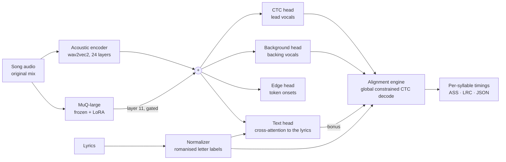

<p align="center">
  <picture>
    <source media="(prefers-color-scheme: dark)" srcset="docs/assets/echora-kara-logo-dark.svg">
    
  </picture>
</p>

<p align="center"><b>Syllable-level lyrics alignment for karaoke, directly on the original song mix.</b></p>

Echora Kara takes a song and its lyrics and works out when each word and syllable is sung, so that karaoke
highlighting follows the voice. It runs on the full mix: there is no vocal-separation step at inference.
It is the karaoke engine behind [Echora](https://github.com/hackslashX/echora), and works as a standalone
library and command-line tool.

This repository holds everything needed to reproduce the model:

- **Inference and the alignment engine**: emission extraction, a global CTC decoder with duration and
  vocal-activity constraints, backing-vocal decoding and ASS / LRC output.
- **The model**: an acoustic CTC aligner with MuQ music-feature fusion, an onset head, a background-vocal
  head and a text-conditioned alignment head.
- **The lyric normalizer**: romanised, pronunciation-aware letter labels for many languages and scripts.
- **Dataset preparation**: turning word-timed lyrics (TTML) and audio into training manifests, with
  quality gates and artist-disjoint splits.
- **Training**: the trainer, its losses and schedules, and decoded evaluation.

## How it works



1. **Normalize the lyrics.** Each line is turned into a sequence of acoustic units (roughly syllables),
   each spelled with a 30-symbol alphabet: `a`–`z`, apostrophe, word separator, unknown and blank. English,
   German and French are spelled by sound. Other scripts are romanised by reading (see [Labels](#labels)).
2. **Compute frame posteriors.** The encoder turns 16 kHz audio into 20 ms frames, in 45 s chunks with
   shared context that are stitched on an exact frame clock. MuQ features are fused into every frame, and
   each head produces its own per-frame output.
3. **Decode the whole song at once.** The engine runs one constrained Viterbi alignment of all lyric
   units against the full song's posteriors. It penalises frames without vocal activity, discourages
   gaps inside a line, enforces paced minimum durations, and adds the text head's per-frame evidence as a
   bonus. Lines that are entirely backing vocals are decoded separately on the background head, so they
   can overlap the lead.
4. **Write timings.** Unit boundaries become line, word and syllable times, exported as ASS (karaoke
   `\k` tags), enhanced LRC and a JSON alignment document.

## Model

| Component | What it is | Parameters |
|---|---|---|
| Acoustic encoder | wav2vec2-style transformer, 24 layers, width 1024, 16 heads, convolutional front end (stride 320 at 16 kHz, so 20 ms frames). Initialised from Meta's omniASR CTC 300M v2, converted to Hugging Face `Wav2Vec2ForCTC` with a parity check | 315 M |
| CTC head | linear, 30 outputs (letters, apostrophe, word separator, unknown, blank) | 31 k |
| MuQ fusion | MuQ-large (`OpenMuQ/MuQ-large-msd-iter`), frozen, run at 24 kHz. Hidden layer 11 is resampled to the 20 ms clock, projected to width 1024 and added to the encoder output through a learned gate that starts at zero, so training begins from the plain aligner | 1.05 M projection |
| MuQ LoRA | low-rank adapters (rank 32, alpha 64) on MuQ blocks 4–11, on the attention query/value projections and both feed-forward layers; new adapter weights start at zero | 6.3 M |
| Edge head | per-frame logit that a new acoustic unit starts on this frame | 1 k |
| Background head | a second CTC head trained on backing-vocal phrases, decoded on its own path | 31 k |
| Text head | 6 text-encoder layers over the song's letters (letter, in-line position and line embeddings), then 4 cross-attention layers from audio frames to text (width 512, 8 heads, QK-norm). Per frame it predicts which letter is being sung and whether the lead and backing voices are singing | 38.3 M |

That is about 361 M trainable parameters, plus the frozen MuQ encoder. MuQ is the only component that
has seen music beyond the training set, and it is what keeps the aligner on the voice in dense mixes.

### Labels

Targets are per-letter romanised spellings of each acoustic unit, at most 6 letters long. The normalizer
(`echora_kara.text`) is shared by dataset preparation and inference, so training and alignment always use
identical labels. Label-rule sets are versioned (`v1`, `v2`, `v3`, `v3-sung`, plus orthographic variants).
A model must be run with the rule set it was trained on, and checkpoints record it.

- **English, German, French**: spelled by pronunciation. Words go through the CMU Pronouncing Dictionary,
  then espeak-ng, with number words, acronyms, vocables and slang handled. `v3-sung` resolves reduced
  vowels to their spelled vowel, as they are sung, and cuts long words into syllables through a
  spelling-to-phoneme alignment.
- **Japanese**: kana readings (JMdict furigana, KANJIDIC2, pykakasi), split per kana.
- **Korean**: Hangul pronunciation rules (liaison, assimilation), then romanisation.
- **Chinese**: Mandarin pinyin and Cantonese jyutping, without tones.
- **Thai, Indic and other scripts**: romanisation per script (PyThaiNLP, uroman and dedicated rules).
- Language is identified per document and per line (fastText `lid.176`) to pick the right rules.

### Training

- **Data**: word- or syllable-timed lyrics in TTML, paired with the original audio. Training uses full
  mixes. Isolated vocal stems are optional and only feed offline vocal-activity estimates for trimming.
- **Windows**: 20–27 s windows that end in gaps between sung fragments, preferring line changes, so units
  are rarely cut.
- **Losses**:
  - a constrained-alignment CTC loss, where paths are limited to each unit's labelled span with ±1 frame
    tolerance;
  - the edge loss (weighted BCE plus an earth-mover term on onset positions);
  - a background-head CTC loss;
  - the text-head losses (letter cross-entropy, singing BCE and a forward-sum alignment term) for lead and
    backing voices.
- **Optimiser**: AdamW with separate parameter groups and learning rates for the encoder, fusion, LoRA,
  background head and text head. The text head uses weight decay. Schedules are warm-up/stable/decay
  (WSD) or cosine. Every stable-phase checkpoint keeps its optimiser state, so it can be extended or
  branched into its own decay.
- **Evaluation**: besides frame metrics, each evaluation decodes held-out songs end to end with the
  production decoder and reports word-start error (median, mean, share over 500 ms).

## Repository layout

```
src/echora_kara/
  engine/      CTC alignment engine and the emission/decoding aligner
  model/       MuQ fusion, LoRA, text head, song-text features
  text/        lyric normalizer and label rules
  inference/   command line, worker, ASS/LRC writers
  data/        dataset preparation: TTML parsing, manifests, gates, vocal activity
  train/       trainer, targets, augmentation, checkpoint tools, omniASR conversion
  evaluation/  decoding and scoring used by the trainer's decoded evaluation
scripts/       resource download
```

## Installation

Requirements: Python 3.12, a CUDA GPU for training (inference also runs on CPU, slowly), and
`espeak-ng` 1.51 or 1.52 from your system packages.

```sh
uv venv -p 3.12 && uv pip install -e ".[train,data]"   # or: pip install -e ".[train,data]"
sh scripts/fetch_resources.sh                          # dictionaries, CMUdict, fastText LID model
export ECHORA_KARA_LID_MODEL=$PWD/resources/lid.176.ftz
```

## Usage

### Align a song

Put the lyrics in a text file, one sung line per line. Lines entirely in brackets, such as `(so lonely)`,
are treated as backing vocals. Then run:

```sh
mkdir work && cp lyrics.txt work/i.txt
echora-kara-align --path_io work --input_audio /music/song.flac --input_text i.txt \
  --model yohane --hf_model_path /models/echora-kara --fusion on --label_rules v3-sung --lang auto \
  --head_correct 0 --tail_correct 0 --timing_offset_ms 0 \
  --min_token_ms 100 --min_letter_ms 40 --duration_pace_ratio 0.9 --vocal_activity_weight 2.0 \
  --exact_frame_clock --blank_free_tokens --background_decoding
```

This writes `work/o.ass`, `work/o_ruby.lrc` and `work/o.alignment.json`, the full alignment document
with per-token times and diagnostics. These flags are the recommended decoder settings:

| Flag / variable | Effect |
|---|---|
| `--fusion on` | load the MuQ branch for checkpoints trained with it; `gate0` runs the same checkpoint without MuQ, for ablation |
| `--label_rules` | must match the rules the checkpoint was trained with |
| `--blank_free_tokens` | no blank frames inside a unit, as in training, so held notes stay on their word |
| `--background_decoding` | decode whole backing-vocal lines on the background head, allowing overlap with the lead |
| `--exact_frame_clock` | time each frame at its true receptive-field centre |
| `--min_token_ms`, `--min_letter_ms`, `--duration_pace_ratio` | minimum unit and letter durations, scaled to each line's pace |
| `--vocal_activity_weight` | extra cost for letters placed where the audio is quiet |
| `ECHORA_KARA_TEXT_BONUS=0.3` | weight of the text head's per-frame evidence in the decode |
| `ECHORA_KARA_IN_LINE_GAP_COST=0.2` | cost for opening a gap inside a line |
| `ECHORA_KARA_LID_MODEL` | path to fastText `lid.176.ftz` (default: `resources/lid.176.ftz`) |

`echora-kara-align --help` lists every option. `python -m echora_kara.inference.worker` runs the same
pipeline as a long-lived JSON-lines worker, so a host application can keep the model loaded.

### Prepare a dataset

The builder reads word-timed lyrics in TTML (one `<p>` per line, timed `<span>` words or syllables,
`role="x-bg"` for backing vocals) together with the matching audio. List the recordings in a JSONL
index, one object per recording:

```json
{"id": "USRC17607839", "title": "Song", "artist": "Artist A & Artist B", "duration": 213.4,
 "lyrics": "lyrics/USRC17607839.ttml", "audio": "audio/USRC17607839.m4a"}
```

Optional fields record how reliably the audio and lyrics are known to match the recording ID (see the
`build_manifest` docstring for all of them). Then:

```sh
# Optional: per-frame vocal activity (from isolated stems or a VAD head), used to trim silent
# label tails. This is offline only; inference never separates vocals.
python -m echora_kara.data.vocal_activity --help

python -m echora_kara.data.build_manifest --index recordings.jsonl --audio-root /datasets \
  --output manifests --lid-model resources/lid.176.ftz --workers 12 \
  --label-rules v3-sung --label-policy v2 --offset-gate drop --near-duplicates drop \
  --activity-dir activity/   # optional
python -m echora_kara.data.filter_label_quality --source manifests/compact \
  --output manifests/compact_s4_005 --min 0.05
```

What the builder does:

1. **Normalize and check labels.** Every song is normalized with the selected label rules. Songs with
   too few units, units that are too long, or too little labelled coverage are rejected.
2. **Gate on audio match.** Each song is scored for how well its labels match the audio (MFCC label
   quality and a whole-song offset search). Confirmed offsets and near-duplicate recordings can be
   dropped.
3. **Split.** Artist-disjoint train/validation splits come from connected components of credited
   artists. A frozen test manifest can be held out by both song and artist, and split assignments
   persist across rebuilds.
4. **Cache.** Results are cached per song by content hash, so re-running after adding audio only
   processes the new songs.

### Train

Convert the omniASR CTC checkpoint to Hugging Face format, with the 30-symbol head initialised from the
matching letters:

```sh
python -m echora_kara.train.convert_omniasr --help
python -m echora_kara.train.omniasr_parity --help     # optional: check the conversion against fairseq2
```

Then train on a manifest directory (`train.jsonl`, `validation.jsonl`, `vocab.json`). This is the full
recipe:

```sh
python -m echora_kara.train.train --data manifests/compact_s4_005 --root /datasets --model omniasr-300m-hf \
  --output runs/echora-kara --backbone wav2vec2 \
  --loss constrained_alignment --boundary-tolerance-frames 1 --window-seconds 25 --window-policy snap \
  --batch-size 4 --gradient-accumulation 2 --learning-rate 8e-6 --warmup-steps 1000 \
  --freeze-encoder-steps 1000 --head-warmup-lr 1e-5 \
  --max-steps 200000 --lr-schedule wsd --decay-steps 20000 --eval-steps 2000 --save-steps 2000 \
  --edge-loss-weight 1.0 --edge-positive-weight 20 --edge-emd-weight 1.0 --edge-tolerance-frames 1 \
  --fusion muq --fusion-layer 11 --fusion-model OpenMuQ/MuQ-large-msd-iter --fusion-gate scalar --fusion-lr 8e-5 \
  --fusion-lora-rank 32 --fusion-lora-alpha 64 --fusion-lora-layers 8 --fusion-lora-targets qv_ffn --fusion-lora-lr 8e-5 \
  --background-head-weight 0.5 --background-blank-weight 0.2 --background-blank-bias 5.0 --background-head-lr 8e-4 \
  --song-text-version 2 --text-aligner-weight 0.5 --text-aligner-lr 1e-4 --text-aligner-dim 512 --text-aligner-heads 8 \
  --text-aligner-text-layers 6 --text-aligner-cross-layers 4 --text-aligner-fs-weight 0.02 --text-aligner-back-weight 0.5 \
  --text-aligner-qk-norm --text-aligner-weight-decay 0.05 \
  --decoded-eval-ids heldout_ids.txt --decoded-eval-songs 40 --best-metric decoded_bonus_mean_ms
```

Useful extras:
- `--resume` continues a run on the same data.
- `--init-optimizer-from CHECKPOINT` warm-starts the Adam moments when branching onto new data or a new
  schedule.
- `--fusion-lora-grow` widens a checkpoint's MuQ LoRA (rank, blocks or targets) without changing its
  output at step 0.

## License

Echora Kara is licensed under the [GNU Affero General Public License v3.0](LICENSE).

Model weights that include the MuQ fusion branch inherit MuQ's **CC BY-NC 4.0** licence, so they may
only be used non-commercially. The English, German and French label rules use espeak-ng and phonemizer
(both GPL-3.0). See [NOTICE](NOTICE) for third-party terms.

## Acknowledgements

- **[FA-Kara](https://github.com/moriwx/FA-Kara)** by moriwx (MIT), where this project started. It in turn
  built on [yohane](https://github.com/Japan7/yohane) and
  [Forced-Alignment-For-NicoKara](https://github.com/oHEILIo/Forced-Alignment-For-NicoKara).
- **[Omnilingual ASR](https://github.com/facebookresearch/omnilingual-asr)** (Meta, Apache-2.0) for the
  encoder initialisation.
- **[MuQ](https://github.com/tencent-ailab/MuQ)** (Tencent AI Lab) for music representations.
- **[espeak-ng](https://github.com/espeak-ng/espeak-ng)**, **[phonemizer](https://github.com/bootphon/phonemizer)**,
  the **CMU Pronouncing Dictionary**, **[JMdict / KANJIDIC2](https://www.edrdg.org/)** (EDRDG),
  **[pykakasi](https://codeberg.org/miurahr/pykakasi)**, **[pypinyin](https://github.com/mozillazg/python-pinyin)**,
  **[ToJyutping](https://github.com/CanCLID/ToJyutping)**, **[OpenCC](https://github.com/BYVoid/OpenCC)**,
  **[PyThaiNLP](https://github.com/PyThaiNLP/pythainlp)**, **[uroman](https://github.com/isi-nlp/uroman)**
  and **[fastText](https://fasttext.cc/)** for the lyric normalizer.
